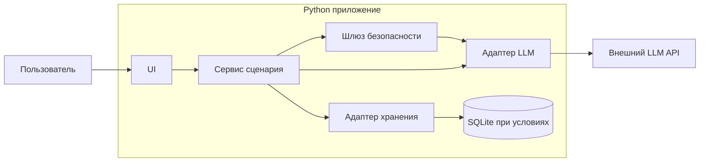
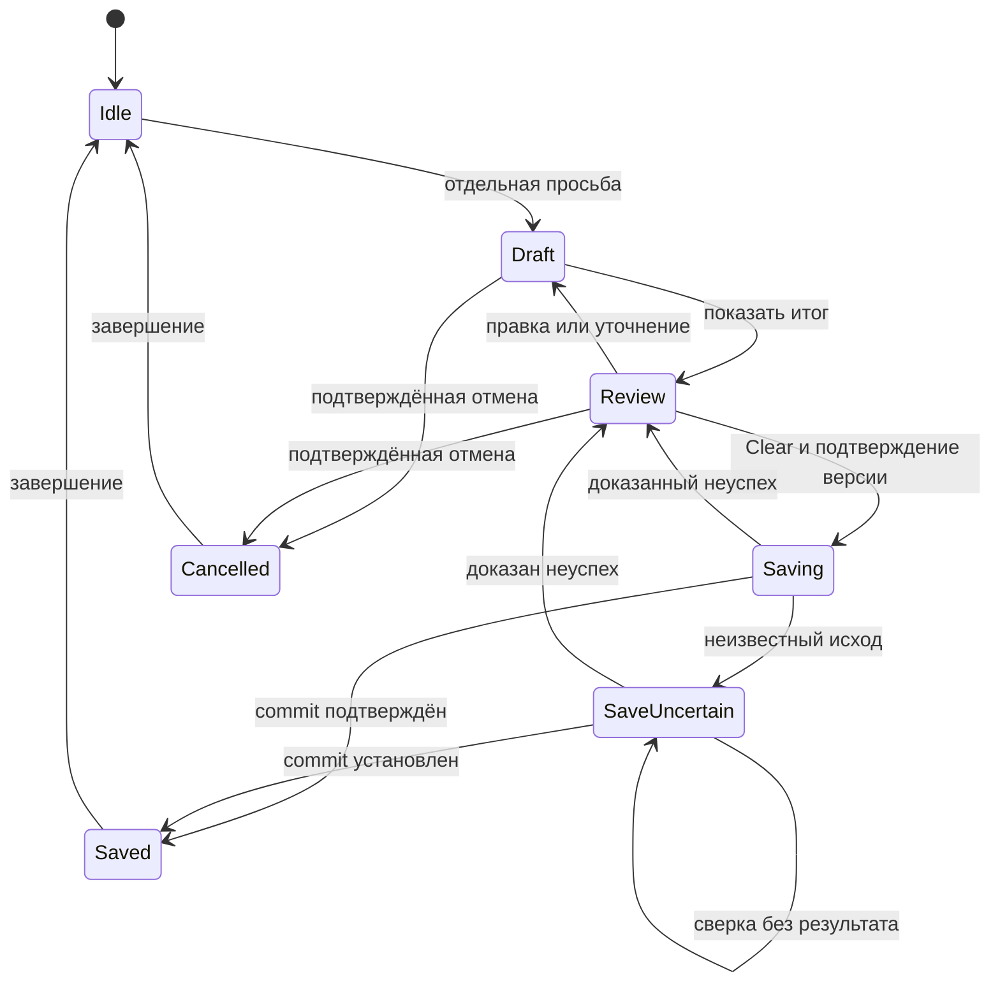
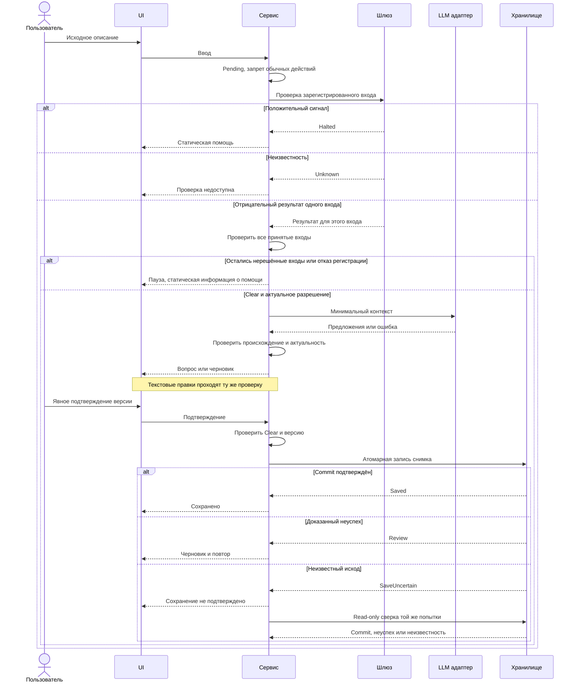

# Предлагаемая архитектура MVP

**Статус:** предложение, не принято. Дата 24.11.2026. [Готовность](architecture-readiness.md) · [реестр](decisions/README.md).

## Границы и принципы

Создание одной записи СМЭР для одного выбранного эпизода; исходный ввод, уточнение, редактирование, пропуск, подтверждение, фактическое сохранение и отмена. Не диагноз, не психотерапия, не реструктуризация; история записей как пользовательская функция не проектируется. Голос H-05 и конкретный UX не утверждены. Ни один вариант UX не предписан архитектурой. Внешняя LLM используется для ограниченной смысловой помощи. В учебном предложении только синтетические данные, локальный или контролируемый демонстрационный доступ; полноценная эксплуатация с личными сведениями заблокирована Q09.

## Компоненты и границы доверия

| Компонент | Ответственность | ADR |
|---|---|---|
| UI | Ввод, отображение черновика/кандидатов, явные действия; не источник истины | 0001, 0006 |
| Сервис сценария | Изолированная сессия, переходы, версия, инварианты, подтверждение | 0002 |
| Шлюз безопасности | До штатного перехода оценивает явный сигнал, при сигнале/неизвестности ограничивает обычный маршрут | 0005 |
| LLM-адаптер | Минимальный контекст, внешнее API, структурный разбор, тайм-аут/ошибки, без прав записи | 0003 |
| Хранилище | Атомарное сохранение подтверждённого итога, идентификатор попытки, проверка результата | 0004 |

Граница браузер/сервер и граница Python/внешний API: данные передаются минимально, ключ только серверный, модель не видит БД и другие записи. Не сохранять полный диалог или исходные аудио; в логах — технические статусы без содержимого, без тела запроса/ответа и ключей. Доступ к стенду и диску ограничен; открытый доступ, реальные данные, сроки удаления, география обработки, идентификация, допустимость обоих LLM-вызовов и политика после остановки остаются Q09. Запрет ввода реальных сведений не считается технической гарантией. Для демонстрации использовать контролируемую среду, синтетические тесты и доказательства. Не заявляется соответствие законам/стандартам.

## Состояние и данные

Источник истины активной записи — сервис в контролируемой живой сессии; подтверждённый итог — хранилище. Учебный профиль предлагается для синтетики, одной сессии и одной вкладки/экземпляра UI. Гарантия одной активной записи — внутри сессии, не по человеку между вкладками/устройствами. Переподключение не гарантирует восстановление, не является обходом незавершённой попытки или safety-блокировки. Потеря сессии завершает прогон, не означает отмену; сверка/возобновление между сессиями и расширение профиля — Q09 до выпуска.

Ситуация — выбранный эпизод или внутренний триггер; мысли, эмоции, телесные и поведенческие реакции могут быть пустыми. Сервис хранит в живой сессии фактические реплики и привязки фрагментов к выбранному эпизоду, кандидатов отдельно, происхождение, пропуски, версию. LLM предлагает; сервис независимо проверяет точное соответствие фрагменту пользовательской реплики выбранного эпизода, правку/отдельное принятие — по фактическому действию для актуальной версии. Чужая/отсутствующая цитата, перефразирование, ложная метка модели — кандидат либо отклонение. Общий Save не принимает кандидатов. Точная цитата не гарантирует правильной категории; смысл и сохранность каждой мысли проверяются по фактическому вводу. Полный диалог постоянно не хранится.

### Жизненный цикл записи

Жизненный цикл отделён от safety-состояния; все обычные действия требуют Clear. Save связывает неизменно ID попытки, эпизод, версию, подтверждённый снимок. SaveUncertain замораживает их: только read-only сверка, без Save/правки/отмены/новой записи. Отсутствие строки при ещё возможном commit и сбой чтения не доказывают неуспех. Установлен commit → Saved той же версии; доказано отсутствие commit и невозможность позднего завершения → Review. Повтор той же версии с прежним ID; новый ID только после доказанного неуспеха, правки и явного подтверждения. При подтверждённой отмене до commit записи нет; после Saved/Cancelled новая запись по отдельной просьбе. Нельзя выдавать неизвестность за успех или отмену.

### Независимая safety-блокировка

| Состояние | Правило |
|---|---|
| Clear | Нет нерешённых принятых safety-входов, отказа регистрации или активной проверки; не доказательство отсутствия угрозы. Новый текст регистрируется до обработки, прежние разрешения инвалидируются. |
| Pending | Идёт одна проверка; обычные действия запрещены. Результат относится только к своему входу/актуальной попытке. При положительном сигнале → Halted. При отрицательном/ошибке проверить следующий ожидающий вход, если он есть. Clear только после разрешения всех входов, иначе Pending/Unknown. |
| Unknown | Нет активной проверки, но есть нерешённые входы или неразрешимый отказ регистрации. Обычный маршрут закрыт. Повтор нерешённых проверок с новыми токенами; недоступность/старый ответ не закрывают вход. |
| Halted | Положительный сигнал; статическая срочная помощь (местная экстренная служба, человек рядом при возможности, чат не оказывает экстренную помощь/психотерапию). Обычный маршрут закрыт, возобновление/удаление Q09. |

**Граница приёма.** UI отключает обычный ввод при Pending/Unknown и Saving/SaveUncertain, оставляет статическую информацию о срочной помощи, статус проверки и доступные безопасные действия. Уже доставленный сервису новый текст B (гонка, устаревший UI) регистрируется отдельно как safety-only, до обработки других результатов/разрешения Save; не заменяет A и не попадает в запись, обычную LLM или очередь эпизодов. Точный повтор ID и текста не создаёт новый вход; иной текст с тем же ID — новый нерешённый вход. Пользователь получает подтверждение только safety-приёма. Проверки сериализованы, каждая с собственным ID входа и токеном попытки: после завершения/тайм-аута текущей проверяется следующий ожидающий, даже если прежний остался Unknown. При отсутствии активной проверки нерешённый вход сохраняет Unknown; можно повторить его проверку. Если шлюз недоступен, отсутствие результата не является отрицательным. Любой действительный положительный сигнал → Halted и прекращение остальных проверок. Только отрицательные результаты для **всех** принятых входов и отсутствие активных/ожидающих/неизвестных проверок допускают Clear. Старый ответ не снимает запрет. Если доставленный текст невозможно зарегистрировать из-за ограничения ресурсов, зафиксировать отказ приёма (Unknown с запретом возобновления либо Pending до завершения уже активной проверки), оставить обычный маршрут закрытым до завершения прогона по Q09; явно сообщить, что текст не принят/не проверен, и показать статическую помощь. Halted не принимает новый обычный текст.

Pending/Unknown/Halted и отказ регистрации блокируют все обычные кнопки Save/Edit/Skip/Cancel/New, обычные повторы, применение поздних ответов и обычные вопросы; запрет с приёма реплики, до асинхронного вызова. После Clear первичный ввод остаётся в живой сессии; если дополнительный вход инвалидировал разрешение, до обычных действий с карточкой нужна новая явная команда обработки первичного ввода либо отказа от него, а для Save — новое подтверждение актуальной версии. Никакого автоматического переноса safety-only текста и автоматического Save; при необходимости текст отдельно вводится заново после Clear. Обычный ответ применим только при актуальных версии/запросе/поколении и Clear. Можно прекратить взаимодействие без утверждения отмены/успеха; при блокировке статическая информация о срочной помощи доступна независимо от шлюза. Перед началом транзакции повторно проверяется Clear; факт уже начатой операции можно сверять read-only, без нового Save и снятия блокировки. Сообщение помощи/недоступности приоритетно. Не обещать клинической детекции. Safety-only входы удерживаются только в живой сессии, не публикуются и не сохраняются в БД/логах; Q07/Q09 охватывают оба вида передачи и политику незавершённых проверок. Подробности — [ADR-0005](decisions/0005-safety-boundary.md).

### Основной маршрут

На диаграмме штатная ветвь после отрицательного результата показана только при Clear и актуальном разрешении; если есть другой нерешённый вход, обычные вызовы/Save не выполняются. При дополнительном входе требуется новое явное продолжение первичного ввода или отказ и новое подтверждение для Save. Обычный сбой LLM после Clear оставляет ввод в живой сессии для повтора или ручной правки. Диаграмма упрощена: safety-блокировка может возникнуть во время Saving/SaveUncertain, тогда сверка не разрешает обычный маршрут. Все разрешения проверяет сервис. См. ADR-0002–0005. Диаграммы смыслово сверены, синтаксис сопоставлен с [Mermaid state](https://mermaid.js.org/syntax/stateDiagram.html) и [sequence](https://mermaid.js.org/syntax/sequenceDiagram.html); технический рендер не выполнен (AR-06): локальный пакет Mermaid найден, но headless Chromium отклоняет навигацию к локальному файлу/серверу (ERR_BLOCKED_BY_ADMINISTRATOR).

## Развёртывание и проверка

Один Python процесс, локальный файл SQLite только при условиях ADR-0004, внешний API по HTTPS после выбора Q07. Веб-UI кандидат (ADR-0006); локальный запуск предпочтителен для воспроизводимости. Стенд — при доступной закрытой среде, секретах вне репозитория, постоянном диске или согласованном временном режиме. Если хост теряет диск, не обещать долговременность. Деплой не выполнен. Не требуется отдельный HTTP backend без нового драйвера.

Проверки: MT-01–05 на выбранном UX, TC-08/09/13/14/15, при C — TC-10/11 и критерии H-04; тесты состояния с fake LLM, отрицательные проверки неверного результата/инъекций/тайм-аута, ложного происхождения, SaveUncertain, safety-блокировки кнопок и поздних ответов, повторных принятых safety-входов, отказа регистрации, границы сессии и повторного сохранения; отдельный вызов внешнего API с синтетическим вводом, чистый запуск и ручные доказательства работы приложения. Ни один из этих тестов реализации пока не выполнен. Подробные API, классы и план реализации не проектируются.

**Planning Readiness Gate: BLOCKED.** Q08 блокирует UI и сценарии; Q07 блокирует рабочую интеграцию; Q09 — данные, доступ, сохранение и выпуск. Даже после снятия блокировок необходимы явное принятие ADR заказчиком и согласованная конфигурация.
