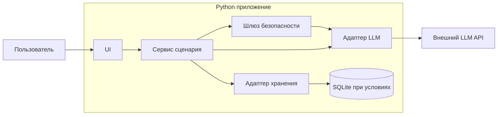
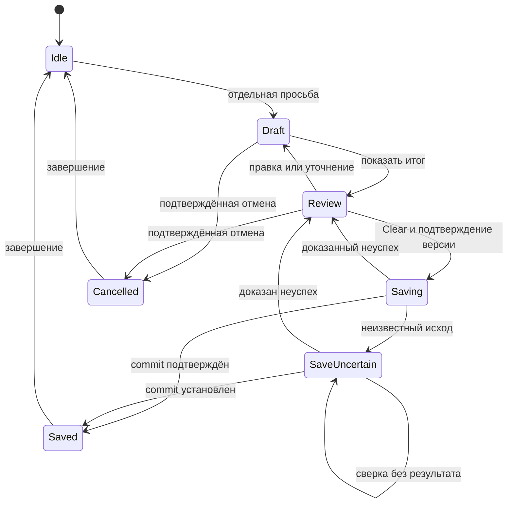
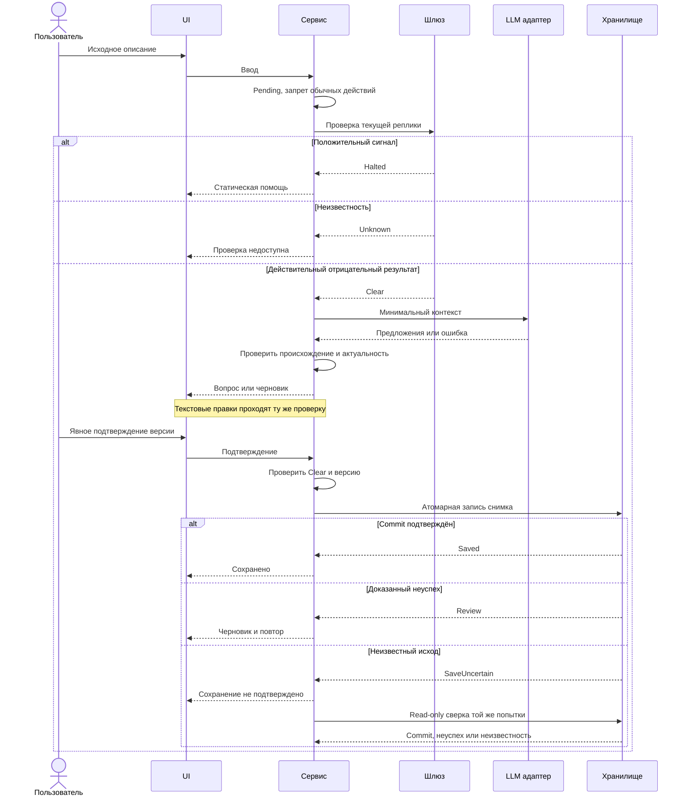

# Предлагаемая архитектура MVP

**Статус:** предложение, не принято. Дата 24.11.2026. [Готовность](architecture-readiness.md) · [реестр](decisions/README.md).

## Границы и принципы

Создание одной записи СМЭР для одного выбранного эпизода; исходный ввод, уточнение, редактирование, пропуск, подтверждение, фактическое сохранение и отмена. Не диагноз, не психотерапия, не реструктуризация; история записей как пользовательская функция не проектируется. Голос H-05 и конкретный UX не утверждены. Ни один вариант UX не предписан архитектурой. Внешняя LLM используется для ограниченной смысловой помощи. В учебном предложении только синтетические данные, локальный или контролируемый демонстрационный доступ; полноценная эксплуатация с личными сведениями заблокирована Q09.

## Компоненты и границы доверия

| Компонент | Ответственность | ADR |
|---|---|---|
| UI | Ввод, отображение черновика/кандидатов, явные действия; не источник истины | 0001, 0006 |
| Сервис сценария | Изолированная сессия, переходы, версия, инварианты, подтверждение | 0002 |
| Шлюз безопасности | До штатного перехода оценивает явный сигнал, при сигнале/неизвестности ограничивает обычный маршрут | 0005 |
| LLM-адаптер | Минимальный контекст, внешнее API, структурный разбор, тайм-аут/ошибки, без прав записи | 0003 |
| Хранилище | Атомарное сохранение подтверждённого итога, идентификатор попытки, проверка результата | 0004 |

Граница браузер/сервер и граница Python/внешний API: данные передаются минимально, ключ только серверный, модель не видит БД и другие записи. Не сохранять полный диалог или исходные аудио; в логах — технические статусы без содержимого, без тела запроса/ответа и ключей. Доступ к стенду и диску ограничен; открытый доступ, реальные данные, сроки удаления, география обработки, идентификация, допустимость обоих LLM-вызовов и политика после остановки остаются Q09. Запрет ввода реальных сведений не считается технической гарантией. Для демонстрации использовать контролируемую среду, синтетические тесты и доказательства. Не заявляется соответствие законам/стандартам.

## Состояние и данные

Источник истины активной записи — сервис в контролируемой живой сессии; подтверждённый итог — хранилище. Учебный профиль предлагается для синтетики, одной сессии и одной вкладки/экземпляра UI. Гарантия одной активной записи — внутри сессии, не по человеку между вкладками/устройствами. Переподключение не гарантирует восстановление, не является обходом незавершённой попытки или safety-блокировки. Потеря сессии завершает прогон, не означает отмену; сверка/возобновление между сессиями и расширение профиля — Q09 до выпуска.

Ситуация — выбранный эпизод или внутренний триггер; мысли, эмоции, телесные и поведенческие реакции могут быть пустыми. Сервис хранит в живой сессии фактические реплики и привязки фрагментов к выбранному эпизоду, кандидатов отдельно, происхождение, пропуски, версию. LLM предлагает; сервис независимо проверяет точное соответствие фрагменту пользовательской реплики выбранного эпизода, правку/отдельное принятие — по фактическому действию для актуальной версии. Чужая/отсутствующая цитата, перефразирование, ложная метка модели — кандидат либо отклонение. Общий Save не принимает кандидатов. Точная цитата не гарантирует правильной категории; смысл и сохранность каждой мысли проверяются по фактическому вводу. Полный диалог постоянно не хранится.

### Жизненный цикл записи

Жизненный цикл отделён от safety-состояния; все обычные действия требуют Clear. Save связывает неизменно ID попытки, эпизод, версию, подтверждённый снимок. SaveUncertain замораживает их: только read-only сверка, без Save/правки/отмены/новой записи. Отсутствие строки при ещё возможном commit и сбой чтения не доказывают неуспех. Установлен commit → Saved той же версии; доказано отсутствие commit и невозможность позднего завершения → Review. Повтор той же версии с прежним ID; новый ID только после доказанного неуспеха, правки и явного подтверждения. При подтверждённой отмене до commit записи нет; после Saved/Cancelled новая запись по отдельной просьбе. Нельзя выдавать неизвестность за успех или отмену.

### Независимая safety-блокировка

| Состояние | Правило |
|---|---|
| Clear | Нет нерешённой проверки; не доказательство отсутствия угрозы. Обычные переходы при прочих выполненных условиях. Новый пользовательский текст до обработки → Pending; прежние разрешения/ответы инвалидируются. |
| Pending | Ожидание текущей проверки; все обычные действия запрещены. Действительный отрицательный результат → Clear, положительный → Halted, ошибка → Unknown. |
| Unknown | Запрет обычного маршрута, сообщение о недоступности. Повтор только той же нерешённой проверки с новым токеном → Pending. Старый результат запрет не снимает. |
| Halted | Положительный сигнал; статическая помощь: срочная местная экстренная служба, человек рядом при возможности, чат не оказывает экстренную помощь/психотерапию. Обычный маршрут закрыт; возобновление и удаление Q09. |

Pending/Unknown/Halted блокируют кнопки Save/Edit/Skip/Cancel/New, обычные повторы, применение поздних ответов и отправку обычного вопроса; запрет действует с приёма реплики до асинхронного вызова. Новый текст при Pending/Unknown не заменяет нерешённую проверку и не меняет запись; распознанный явный сигнал → Halted, иной ввод отклоняется и может быть подан заново после разрешения неизвестности. Можно прекратить взаимодействие без утверждения отмены/успеха. Обычный ответ применим лишь при Clear, актуальных версии, запросе и поколении проверки. Перед транзакцией повторно проверяется Clear; уже начатая операция может завершиться, её факт сверяется read-only, без нового Save или снятия safety-блокировки. Сообщение помощи/недоступности приоритетно. Детекция не гарантирована, неизвестность не равна угрозе или безопасности. Q07/Q09 распространяются на передачу данных обоих видов LLM-вызова.

### Основной маршрут

Обычный сбой LLM после Clear оставляет ввод в живой сессии для повтора или ручной правки. Диаграмма упрощена: safety-блокировка может возникнуть во время Saving/SaveUncertain, тогда сверка не разрешает обычный маршрут. Все разрешения проверяет сервис. См. ADR-0002–0005. Диаграммы смыслово сверены, синтаксис сопоставлен с [Mermaid state](https://mermaid.js.org/syntax/stateDiagram.html) и [sequence](https://mermaid.js.org/syntax/sequenceDiagram.html); технический рендер не выполнен (AR-06).

## Развёртывание и проверка

Один Python процесс, локальный файл SQLite только при условиях ADR-0004, внешний API по HTTPS после выбора Q07. Веб-UI кандидат (ADR-0006); локальный запуск предпочтителен для воспроизводимости. Стенд — при доступной закрытой среде, секретах вне репозитория, постоянном диске или согласованном временном режиме. Если хост теряет диск, не обещать долговременность. Деплой не выполнен. Не требуется отдельный HTTP backend без нового драйвера.

Проверки: MT-01–05 на выбранном UX, TC-08/09/13/14/15, при C — TC-10/11 и критерии H-04; тесты состояния с fake LLM, отрицательные проверки неверного результата/инъекций/тайм-аута, ложного происхождения, SaveUncertain, safety-блокировки кнопок и поздних ответов, границы сессии и повторного сохранения; отдельный вызов внешнего API с синтетическим вводом, чистый запуск и ручные доказательства работы приложения. Ни один из этих тестов реализации пока не выполнен. Подробные API, классы и план реализации не проектируются.

**Planning Readiness Gate: BLOCKED.** Q08 блокирует UI и сценарии; Q07 блокирует рабочую интеграцию; Q09 — данные, доступ, сохранение и выпуск. Даже после снятия блокировок необходимы явное принятие ADR заказчиком и согласованная конфигурация.
