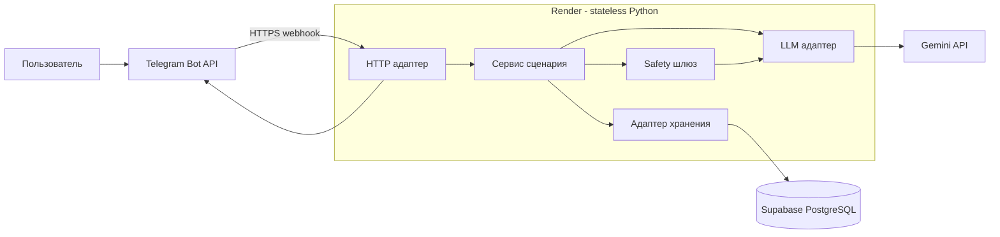
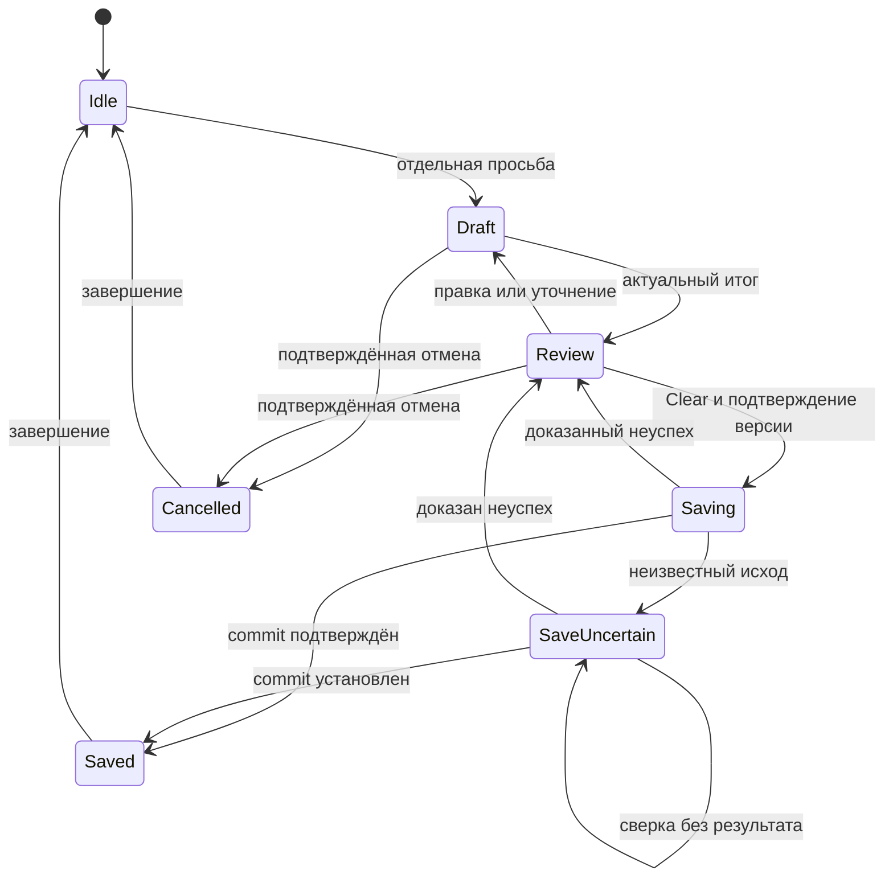
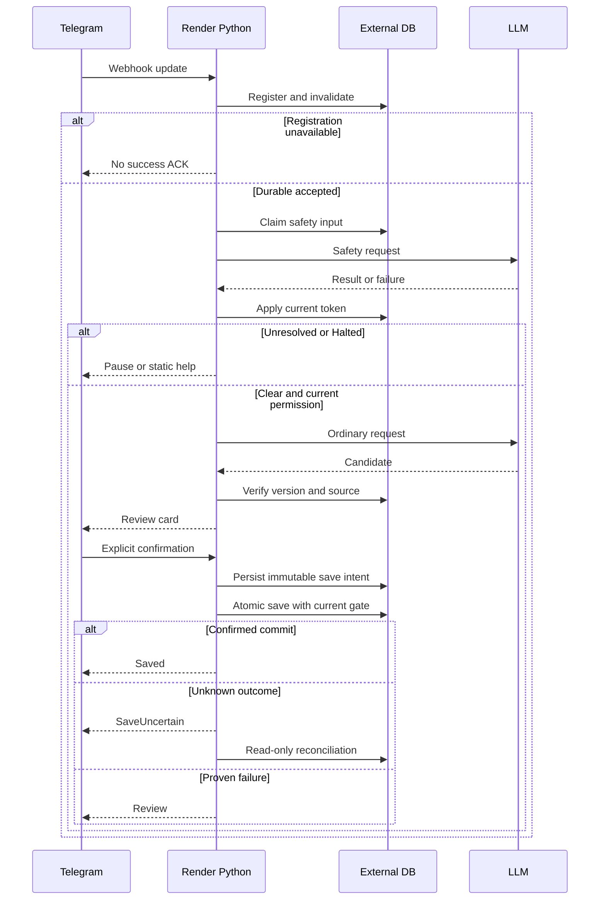

# Архитектура MVP дневника СМЭР

**Статус:** решения ADR-0001–0006 согласованы заказчиком; Gemini выбран как направление учебного MVP, конкретная модель/условия ADR-0007 ещё проверяются. Render/stateless/no local storage — требования. Planning Readiness Gate: BLOCKED. [Readiness](architecture-readiness.md) · [Реестр](decisions/README.md) · [Обработка комментариев](architecture-review.md#обработка-комментариев-заказчика).

## Контекст и границы

До 10 пользователей, ожидаемый входной поток менее 1 запроса/с, дедлайн 07.12.2026. Одна активная запись одного эпизода, текстовый сценарий, авторство, частичность, явное подтверждение, отмена, реальное сохранение; без диагностики/психотерапии, без истории как новой продуктовой функции. Для MVP согласован [UX‑A](../product/interaction-spec.md). Голос отложен по Q10. На старте заказчик не планирует чувствительные данные и пользователей ЕЭЗ/Швейцарии/Великобритании; для Gemini Free предлагается закрытая демонстрация на полностью вымышленных эпизодах, с проверкой взрослого возраста/доступных регионов и допуска Q09. Реальные данные и расширение аудитории не разрешены, сроки хранения и допуск передачи требуют уточнения. Не считать бесплатный тариф гарантией достаточности.

## Компоненты и границы доверия

Выбранная конфигурация: Telegram + stateless Python HTTP-сервис на Render + Supabase PostgreSQL + Gemini API. FastAPI и Gemini 3.5 Flash-Lite — рекомендуемые технические кандидаты, тарифы/квоты требуют проверки. Render Postgres разрешён для отдельного stage/demo с тем же контрактом, раздельными секретами и синтетикой (ADR-0004), не второй источник истины. Веб-UI, Neon, Groq — альтернативы при пересмотре. Никаких локальных файлов/SQLite, stateful UI, локальных очередей как источника истины. Один Render Web Service; все обязательные состояния во внешней БД, локальные переменные/пулы не авторитетны. Не нужен отдельный frontend/микросервисы/брокер при текущих требованиях. Внешний API из Python. Render Free — кандидат с холодным стартом, эфемерной файловой системой, лимитом часов workspace; не гарантируем задержку/доступность.

| Компонент | Ответственность |
|---|---|
| Telegram | Ввод, карточка, действия, отображение статуса; не источник истины |
| HTTP-адаптер | HTTPS, секрет webhook, проверка отправителя, ID события, доставка/повторы |
| Сервис сценария | Авторитетное чтение БД, транзакционные переходы, версия/авторство, защита от повторов |
| Safety/LLM | Каждый принятый вход учтён, узкий внешний вызов, проверка ответа, статическая помощь без LLM |
| Внешняя БД | Активная запись, ограниченные исходные фрагменты, версии, safety/inbox/claim, immutable попытка, подтверждённый итог, лимиты |

Границы Telegram→Render→БД/LLM. Секреты только server env; токены, user_id и тексты не в логах/публичных доказательствах. Идентификация по авторизованному ID и внутреннему псевдониму, не username. Для Telegram личный чат, allowlist (предложение), не E2E; канал, внешняя БД и LLM — разные обработчики данных. Условия использования/допуск Q09; не заявлять правовое/медицинское соответствие. [ADR-0004](decisions/0004-persistence.md) отделяет оперативный набор от подтверждённого дневника. По C-14 аналитические блоки исключены из схемы MVP: нет runtime-аналитики, CSV-потока и доступа аналитической LLM к данным. Возможность будущего анализа — отдельный вопрос, не обязательство этого MVP. Это не отменяет минимизацию и условия обработки данных текущими сервисами. Для Gemini Free допуск вымышленного текста до передачи обоим LLM-маршрутам остаётся частью Q09; предупреждение в Telegram само по себе не гарантирует отсутствие личного текста. Safety-only не попадает в обычный LLM, дневник или экспорт; очищается по согласованной политике, не снимающей блокировку.

## Жизненный цикл записи

Состояние каждого субъекта во внешней транзакционной БД; один активный эпизод по авторизованному субъекту приложения, не глобальная уникальность человека между аккаунтами. Новый эпизод после завершения только по отдельной просьбе. Ситуация/триггер обязателен, остальные поля могут быть пусты; мысли/эмоции/телесные и поведенческие реакции сохраняются только с проверяемым источником или отдельным пользовательским действием. LLM-метки не авторство; спорные кандидаты отдельно; общий Save их не принимает, смысл оценивает человек. Правка инвалидирует прежнее подтверждение.

Все обычные переходы требуют Clear и актуальной версии/разрешения. Save связывает ID, субъект, эпизод, версию и снимок; durable намерение/Saving фиксируется до транзакции карточки. В отдельной транзакции под той же блокировкой субъекта вновь проверяется актуальность/допуск, атомарно пишутся карточка и Saved с уникальным ключом. Рестарт между шагами требует сверки, аннулирования старого права записи при доказанном неуспехе и нового подтверждения; не автоматический Save. SaveUncertain замораживает снимок и запрещает Save/Edit/Cancel/New до авторитетной сверки. Отсутствие строки при возможном позднем commit не доказывает откат. При подтверждённом commit — Saved той же версии, при доказанном неуспехе — Review и повтор того же снимка с прежним ID; новая версия требует нового подтверждения. Отмена не отменяет уже совершённый commit. Сверка read-only не снимает safety. Рестарт Render/переподключение не создаёт новую запись, не превращает нерешённость в Clear.

## Независимая safety-блокировка и доставка

| Состояние | Правило |
|---|---|
| Clear | Все durably принятые safety-входы отрицательны, нет активных/ожидающих/неизвестных проверок/отказа регистрации; не медицинская оценка |
| Pending | Одна активная проверка, обычный маршрут закрыт, ID входа и токен конкретной попытки |
| Unknown | Нерешённые входы без активной проверки либо durable отказ регистрации; повтор той же проверки с новым токеном, при неразрешимом отказе не возобновлять |
| Halted | Положительный сигнал; статическая срочная помощь, человек рядом при возможности, приложение не оказывает экстренную помощь/психотерапию; нет штатного выхода до Q09 |

Приём входа, дедупликация по update_id/request_id, запись нерешённости и инвалидация разрешения — транзакционно до подтверждения приёма. При паузе/Saving/SaveUncertain дополнительный свободный текст B учитывается отдельно как safety-only; Telegram не может отключить отправку текста, сервер блокирует обычные действия и показывает статус/статическую помощь. Точный дубль не новый вход; отличающийся текст под тем же транспортным ID — новый нерешённый safety-вход с отдельным внутренним ID (при невозможности регистрации — явный отказ с блокировкой), не отрицательный результат. Уникальный транспортный ID дедуплицируется вместе с отпечатком содержимого. Проверки сериализованы по субъекту; после завершения/тайм-аута A следующий вход B может проверяться даже при Unknown A; результат относится только к ID/токену, отрицательный A не закрывает B. Clear только после всех отрицательных результатов, положительный → Halted, старый ответ не снимает запрет. После разрешения дополнительного входа требуется новое явное продолжение/отказ от первичного ввода, для Save — новое подтверждение. Никакого автоматического переноса safety-only или старого Save.

БД хранит claim/lease и состояние обработки, внешний вызов вне транзакции; результат применяется после сверки версии/поколения/токена. Истёкший claim/рестарт оставляет вход нерешённым; продолжение/повтор по следующему запросу, без обещания фонового выполнения на спящем Render. При доступной БД и невозможности регистрации тела — durable отказ с запретом до согласованной процедуры. При недоступной БД не ACK как принятый, не делать обычную обработку/Save, по возможности показать статическую помощь; повтор доставки сначала сверяет ID. Не обещать доставку/порядок Telegram или обнаружение недоставленного текста, гарантии охватывают зарегистрированные входы. При одновременном входе и Save транзакционная граница определяет порядок: принятый раньше вход блокирует начало сохранения; ранее начатый/совершённый commit может быть только сверен, не отменён. Статическая помощь приоритетна над обычным ответом; фактическая доставка сообщения внешним каналом не гарантирована.

## Основной маршрут и отказоустойчивость

Упрощённая диаграмма: каждый новый свободный текст до обычного маршрута регистрируется, даже во время паузы, если доставлен; Clear требует всех входов. Сохранение только по явному действию актуальной версии. Принимаем webhook 2xx лишь после доказанного durable приёма и определённого безопасного статуса обработки (либо запись о незавершённой работе, которую можно восстановить); ни один принятый вход не зависит от выполнения фоновой задачи в RAM. Не обещаем exactly-once исходящих Telegram сообщений: фактический commit и доставка различны. Все три диаграммы прошли технический рендер Mermaid CLI при финальном аудите PR №2.

## Развёртывание, проверка и решения

Render — зафиксирован заказчиком, тариф Free условен. [ADR-0001](decisions/0001-application-topology.md) — один сервис; [ADR-0006](decisions/0006-interface.md) — Telegram; [ADR-0004](decisions/0004-persistence.md) — Supabase, опционально отдельный stage/demo Render Postgres; [ADR-0007](decisions/0007-llm-provider.md) — Gemini, проверка модели и квот. Smoke-test внешних БД/LLM из Render, холодный старт, рестарт, дедупликация, конкурентные операции/изоляция, недоступная БД, safety и SaveUncertain, отсутствие аналитического доступа/экспорта, при использовании stage — контракт и изоляция окружений. MT-01–05 — материалы веб-прототипа UX‑A, TC-08/09/13–15, W1–W19 и C-W01–C-W10 — документальные маршруты. Реализация, развёртывание и аккаунты не тестировались. Инструкция преподавателю и синтетические скриншоты/видео обязательны. Q08 закрыт выбором UX‑A. Q07/Q11 требуют проверок выбранных поставщиков и конкретной конфигурации, Q09 — решения по данным и доступу. ADR-0001–0006 приняты, ADR-0007 Proposed в части модели и условий. Для пересмотра Gate нужны проверки, решения и повторное независимое ревью по [Readiness](architecture-readiness.md). Planning Readiness Gate: **BLOCKED**.
