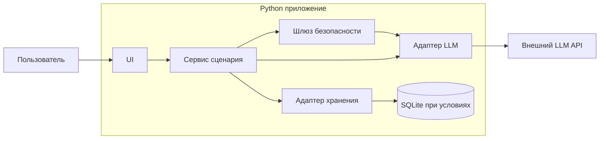
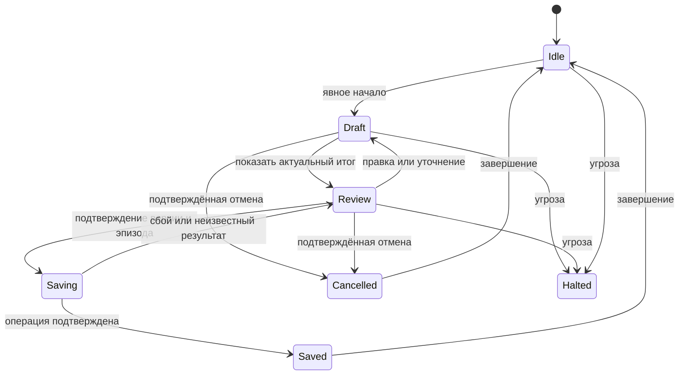
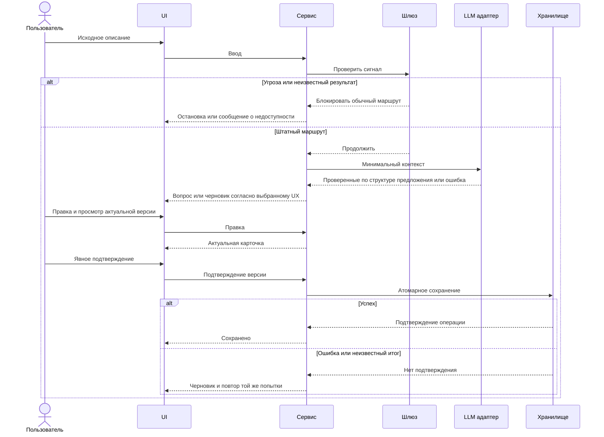

# Предлагаемая архитектура MVP

**Статус:** предложение, не принято. Дата 24.11.2026. [Готовность](architecture-readiness.md) · [реестр](decisions/README.md).

## Границы и принципы

Создание одной записи СМЭР для одного выбранного эпизода; исходный ввод, уточнение, редактирование, пропуск, подтверждение, фактическое сохранение и отмена. Не диагноз, не психотерапия, не реструктуризация; история записей как пользовательская функция не проектируется. Голос H-05 и конкретный UX не утверждены. Ни один вариант UX не предписан архитектурой. Внешняя LLM используется для ограниченной смысловой помощи. В учебном предложении только синтетические данные, локальный или контролируемый демонстрационный доступ; полноценная эксплуатация с личными сведениями заблокирована Q09.

## Компоненты и границы доверия

| Компонент | Ответственность | ADR |
|---|---|---|
| UI | Ввод, отображение черновика/кандидатов, явные действия; не источник истины | 0001, 0006 |
| Сервис сценария | Изолированная сессия, переходы, версия, инварианты, подтверждение | 0002 |
| Шлюз безопасности | До штатного перехода оценивает явный сигнал, при сигнале/неизвестности ограничивает обычный маршрут | 0005 |
| LLM-адаптер | Минимальный контекст, внешнее API, структурный разбор, тайм-аут/ошибки, без прав записи | 0003 |
| Хранилище | Атомарное сохранение подтверждённого итога, идентификатор попытки, проверка результата | 0004 |

Граница браузер/сервер и граница Python/внешний API: данные передаются минимально, ключ только серверный, модель не видит БД и другие записи. Не сохранять полный диалог или исходные аудио; в логах — технические статусы без содержимого, без тела запроса/ответа и ключей. Доступ к стенду и диску ограничен; открытый доступ, реальные данные, сроки удаления, география обработки и идентификация остаются Q09. Запрет ввода реальных сведений не считается технической гарантией. Для демонстрации использовать контролируемую среду, синтетические тесты и доказательства. Не заявляется соответствие законам/стандартам.

## Состояние и данные

Источник истины активной записи — состояние сервиса в изолированной сессии; подтверждённый итог после успешной операции — хранилище. Ситуация: определённый эпизод или внутренний триггер, мысли: собственные формулировки/образы, эмоции: собственные переживания, реакции: тело и действия. Поля могут быть пустыми кроме ситуации. В черновике отдельно кандидаты, происхождение каждой смысловой единицы, пропуски и версия. Удалённое или непринятое предложение не попадает в итог. Общая кнопка сохранения не принимает кандидаты. Исходные фрагменты доступны на время проверки, не обязательны в постоянной записи. После подтверждённой отмены нет сохранённой записи; второй эпизод не ставится в очередь. Разделение по человеку между вкладками требует Q09.

Остановленное состояние не имеет штатного выхода до согласования политики; неопределённый результат проверки безопасности временно блокирует обработку, без утверждения наличия угрозы. Любой новый текст до перехода проверяется шлюзом, включая текст перед подтверждением; уже начатую атомарную запись нельзя обещать отменить задним числом, поэтому команды сериализуются, перед началом операции проверяется актуальное состояние. Одновременная угроза/подтверждение требует отрицательного теста порядка обработки. Подтверждение устаревшей версии отклоняется.

Диаграмма упрощена: все новые текстовые реплики (включая правки и текстовые подтверждения) проходят шлюз; кнопка подтверждения не подменяет проверку версии и состояния. Ошибка штатной LLM после успешной проверки безопасности оставляет ввод доступным для повтора или ручной правки; невалидные предложения не применяются. Поздний ответ не меняет новую версию. Диаграммы сверены по смыслу с ADR; технический рендеринг не проверен.

## Развёртывание и проверка

Один Python процесс, локальный файл SQLite только при условиях ADR-0004, внешний API по HTTPS после выбора Q07. Веб-UI кандидат (ADR-0006); локальный запуск предпочтителен для воспроизводимости. Стенд — при доступной закрытой среде, секретах вне репозитория, постоянном диске или согласованном временном режиме. Если хост теряет диск, не обещать долговременность. Деплой не выполнен. Не требуется отдельный HTTP backend без нового драйвера.

Проверки: MT-01–05 на выбранном UX, TC-08/09/13/14/15, при C — TC-10/11 и критерии H-04; тесты состояния с fake LLM, отрицательные проверки неверного результата/инъекций/тайм-аута, изоляции, повторного сохранения; отдельный вызов внешнего API с синтетическим вводом, чистый запуск и ручные доказательства работы приложения. Ни один из этих тестов реализации пока не выполнен. Подробные API, классы и план реализации не проектируются.

**Planning Readiness Gate: BLOCKED.** Q08 блокирует UI и сценарии; Q07 блокирует рабочую интеграцию; Q09 — данные, доступ, сохранение и выпуск. Даже после снятия блокировок необходимы явное принятие ADR заказчиком и согласованная конфигурация.
